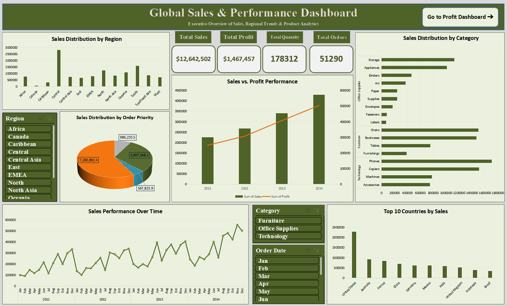
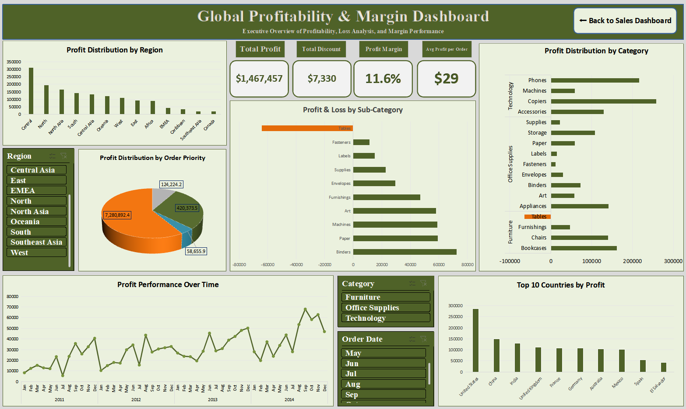

# 📊 Global Sales & Profitability Analytics Dashboard

## 📖 Introduction & Project Overview
In today's globalized retail and enterprise environments, tracking overall revenue is only half the battle. A business might experience skyrocketing sales while silently suffering from shrinking net profit margins due to high shipping costs, excessive discounting, or unprofitable product lines.

This project delivers an **end-to-end Executive Business Intelligence (BI) Dashboard Solution** developed in **Microsoft Excel**. The core objective of this project is to bridge the gap between high-level sales performance and low-level profitability drivers. By transforming over 50,000 raw transactional records into a multi-paged, interactive, and visually refined dashboard, this solution enables C-suite executives and managers to drill down into global performance, identify operational bottlenecks, and make data-driven decisions to maximize profitability.

---

## 🎯 Project Objectives & Problem Statement

### 1. Problem Statement
The enterprise faces challenges in understanding true profitability across diverse global markets, product sub-categories, and fulfillment modes. While certain regions generate substantial revenue, net profits are heavily offset by hidden operational inefficiencies, regional discounting, and high return/shipping costs.

### 2. Key Objectives
* **Revenue vs. Profitability Alignment:** Evaluate whether top-selling products and regions actually yield high net profit margins.
* **Loss-Making Product Detection:** Pinpoint specific product sub-categories operating at a net loss to initiate targeted pricing or supply chain adjustments.
* **Geographical & Temporal Profiling:** Identify peak sales seasons (2011-2014) and determine high-performing regional markets across North America, Europe, Asia, and Latin America.
* **Executive Decision Support:** Build a 2-page dynamic, interactive UI/UX interface using Slicers, KPIs, and specialized data charts to simplify complex data exploration.

---

## 🛠️ Tools & Technologies Used

* **Microsoft Excel (Core Platform):**
  * **Data Cleaning & Preprocessing:** Power Query / Advanced Formulas (TEXT, DATE, IF, VLOOKUP/XLOOKUP).
  * **Data Modeling & Aggregation:** Advanced Pivot Tables, Calculated Fields, Summarized Measures.
  * **Data Visualization & UI Design:** Custom Pivot Charts (Bar, Donut, Line, Column), Dynamic Slicers, Conditional Formatting (Invert if Negative), and Custom Color Themes (Emerald/Corporate Palette).
* **Git & GitHub / Kaggle:** Portfolio hosting and project documentation.

---

## 📸 Dashboard Previews

### 1. Sales & Market Performance Dashboard

### 2. Profitability & Loss Analysis Dashboard

---

## 🏗️ Project Architecture & Workflow

The analytics workflow was structured into four distinct phases:

### Phase 1: Data Preprocessing & Quality Assurance
* **Temporal Standardization:** Parsed and transformed raw Order Date and Ship Date fields into standardized temporal dimensions (Year, Quarter, Month) to enable multi-year time-series analysis.
* **Data Integrity Audit:** Checked for missing values, validated numerical data types for monetary fields (Sales, Profit, Discount, Quantity), and removed redundant duplicate records.
* **Categorical Alignment:** Cleaned and standardized geographical regions, country names, and product sub-categories to maintain uniform filtering across all dynamic visuals.

### Phase 2: Data Modeling & Metrics Calculation
Constructed dedicated, isolated Pivot Tables for each visual representation to preserve layout integrity and optimize calculation speed. Engineered key performance indicators (KPIs) and custom measures including:
* **Total Sales Revenue:** Calculated as the aggregate sum of all sales values.
* **Total Net Profit:** Calculated as the net sum of all profit contributions across transactions.
* **Overall Profit Margin (%):** Built using an advanced Calculated Field (`Profit Margin = Sum(Profit) / Sum(Sales)`).
* **Average Profit per Order:** Evaluated transaction efficiency using `AVERAGE(Profit)`.
* **Total Discount Impact:** Measured the total monetary revenue given away through discounts using `SUM(Discount)`.

### Phase 3: Dashboard Architecture & Visual UI/UX
Developed a clean, 2-page executive business intelligence suite using a cohesive corporate color scheme and dynamic interactive controls:

#### 1. Sales Dashboard (Market Performance Overview)
* **Executive KPIs:** Real-time summary cards for Total Sales, Order Volume, Total Quantity Sold, and Average Order Value.
* **Geographical Distribution:** Visual breakdown of sales performance across global regions (Central, North, South, EMEA, Asia, etc.).
* **Order Priority Breakdown:** Analyzed fulfillment priority levels (Critical, High, Medium, Low) to understand delivery urgency distribution.
* **Historical Sales Momentum (2011-2014):** Monthly time-series trend line tracking long-term growth and seasonal cycles.
* **Top 10 Performing Countries:** Identified and ranked the leading international markets by gross revenue.

#### 2. Profitability Dashboard (Profitability & Loss Analysis)
* **Profitability KPIs:** High-level metrics showing Total Profit ($1.46M+), Total Discounts ($7.3K+), Profit Margin (11.6%), and Avg Profit per Order ($29).
* **Sub-Category Profit & Loss Analysis:** Specialized bar visual utilizing "Invert if Negative" conditional formatting to immediately highlight deficit product lines (e.g., Tables in distinct orange vs. profitable items in dark green).
* **Category Profit Share:** Detailed comparison of net profitability across Technology, Office Supplies, and Furniture.
* **Regional Profit Dynamics:** Cross-regional comparisons isolating high-margin territories from high-volume/low-margin areas.
* **Universal Slicers:** Interactive multi-select slicers for Region, Category, and Order Date driving real-time cross-filtering across the entire dashboard.
* **Interactive Navigation:** Integrated cross-sheet hyperlinks (Buttons) for seamless switching between the Sales and Profitability views.

---

## 📊 Key Business Insights & Findings

1. **The "Tables" Sub-Category Deficit:**
   * Despite generating considerable sales volume, the **Tables** sub-category incurred a substantial net loss (negative profit margin). This indicates potential issues with aggressive discounting, excessive freight/shipping costs, or inadequate pricing strategies.

2. **Technology Drives High Margins:**
   * **Technology** products (specifically Copiers and Phones) consistently yield the highest profit margins globally, making them prime candidates for increased marketing spend and stock prioritization.

3. **Regional High-Performers:**
   * The **United States**, **China**, and **India** lead in absolute profit contributions, while smaller regional markets exhibit potential for margin optimization.

4. **Seasonal Peak Cycles:**
   * Historical trends indicate strong sales and profit spikes toward Q3 and Q4 (September to December), coinciding with global holiday shopping seasons.

---

## 💡 Strategic Recommendations

* **Pricing Strategy Adjustment:** Re-evaluate discount caps on unprofitable lines, particularly in the Furniture category (Tables/Bookcases).
* **Shipping & Logistics Optimization:** Audit fulfillment costs for heavy sub-categories to reduce margin erosion.
* **Resource Allocation:** Double down on inventory expansion for high-margin Technology goods in top-tier markets (US, China, India).
* **Discount Policy Overhaul:** Implement strict discount caps on Furniture sub-categories (like Tables and Bookcases), as the data shows discounts are directly eroding profit margins without proportional volume increases.

---

## 📁 Repository Structure

| File / Folder | Type | Description |
| :--- | :---: | :--- |
| 📊 `Global_Sales_Profitability_Dashboard.xlsx` | Workbook | Interactive Master Excel file (Sales & Profitability tabs) |
| 📝 `README.md` | Document | Complete project documentation, architecture, and business insights |
| 📂 `assets/` | Folder | Contains visual artifacts and screenshots used in the documentation |
| 🖼️ `assets/Sales_Dashboard_Overview.png` | Image | High-resolution preview of the Sales & Market Performance Dashboard |
| 🖼️ `assets/Profit_Dashboard_Overview.png` | Image | High-resolution preview of the Profitability & Loss Analysis Dashboard |

---

## 👤 Author & Contact

* Name: Ahmed
* Role: Data Analyst | Business Intelligence & Data Visualization
* Specialization: Data Cleaning, Pivot Tables, KPI Development & Dashboarding.
* Tools Used: Microsoft Excel (Pivot Tables, Advanced Charting, Dynamic Slicers, KPI Logic)
* GitHub Profile: [https://github.com/ahmedhussein-meteodata]
* Kaggle Profile: [https://www.kaggle.com/ahmedhussein77731]
* LinkedIn Profile: [www.linkedin.com/in/ahmed-hussein-meteodata]